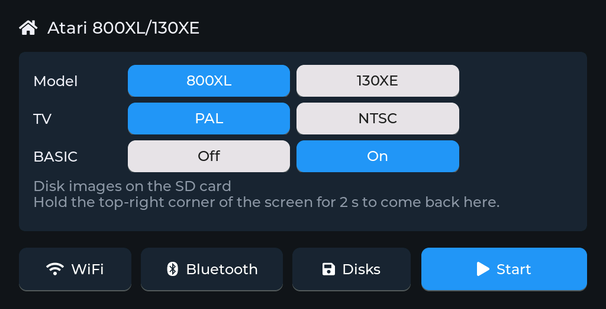
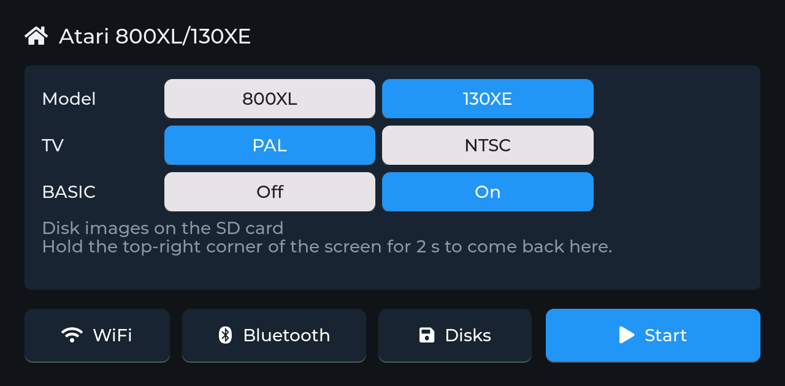

<h1 align="center">esp32emu</h1>

<p align="center">
  <b>The shared board runtime for emulators on the Makerfabs MaTouch ESP32-S3 7" and the M5Stack Tab5 (ESP32-P4).</b><br>
  Used by <a href="https://github.com/rlucencic/esp32ste">esp32ste</a> (Atari STE), <a href="https://github.com/rlucencic/esp32mac">esp32mac</a> (Macintosh Plus, SE, Classic), <a href="https://github.com/rlucencic/esp32cpc">esp32cpc</a> (Amstrad CPC), <a href="https://github.com/rlucencic/esp32zx">esp32zx</a> (ZX Spectrum 128K, +2, +3), <a href="https://github.com/rlucencic/esp32cbm">esp32cbm</a> (Commodore 64, 128), <a href="https://github.com/rlucencic/esp32xl">esp32xl</a> (Atari 800XL, 130XE), <a href="https://github.com/rlucencic/esp32msx">esp32msx</a> (MSX1, MSX2), <a href="https://github.com/rlucencic/esp32gs">esp32gs</a> (Apple IIGS), <a href="https://github.com/rlucencic/esp32coco">esp32coco</a> (Tandy Color Computer 2, 3), <a href="https://github.com/rlucencic/esp32mac2">esp32mac2</a> (Macintosh LC and II, Tab5 only), <a href="https://github.com/rlucencic/esp32mac3">esp32mac3</a> (Macintosh LC II and LC III, Tab5 only), <a href="https://github.com/rlucencic/esp32arc">esp32arc</a> (Acorn Archimedes, Tab5 only) and <a href="https://github.com/rlucencic/esp32pc">esp32pc</a> (IBM PC/XT and PC/AT).
</p>

esp32emu is everything an emulator on these boards needs apart from the
machine itself: the display and touch panel, the SD card, WiFi with the clock
from the internet, Bluetooth keyboards and mice, a setup screen, a web page for
disk images, a serial console for testing, and the CPU cores and chips the
machines share: a 68000 (or 68020), a Z80, a 6502, a 65C816, a 6809, an ARM2, an x86 (8088, 8086, 80286) and a uPD765 floppy controller. A machine
describes itself in one struct, and `emu_run()` does the rest, on either board:
the build target picks it (`esp32s3` the MaTouch, `esp32p4` the Tab5).

## Components

| Component | What |
|---|---|
| `components/musashi` | The 68000 core: [Musashi](https://github.com/kstenerud/Musashi), evansm7's embedded fork, with static opcode tables (see its README); a 68020 with `CONFIG_M68K_68020`, and its FPU as a 68881 |
| `components/z80` | The Z80 core (passes zexall), timed in T-states, optionally with the ZX Spectrum's memory contention, or in Amstrad CPC microseconds, optionally reading unmapped banks through the machine, or with the MSX's memory (eight 8 KB banks and the subslot register at `$FFFF`) (menuconfig **Z80 core**); `test/` runs zexdoc/zexall on a desktop |
| `components/m6502` | The 6502 core (6510, 8502, disk drives, the Atari's 6502C): every bus cycle as on the chip, all 256 opcodes including the undocumented ones, several CPUs at once, cycle stealing (the VIC-II's, or the Atari's ANTIC, whose DMA cycles on a line it skips from a table by itself); `test/` runs Klaus Dormann's functional test on a desktop |
| `components/w65816` | The 65C816 core (the Apple IIGS): emulation and native mode, all 256 opcodes, decimal mode in both widths, memory through tables of 256-byte pages with the machine's callbacks for the rest, vectors from a bank of the machine's choosing; `test/` runs the SingleStepTests 65816 suite (5 million tests, bus cycles included) on a desktop |
| `components/m6809` | The 6809 and 6309 core (the CoCo): each instruction's documented cycles, all of the 6309 (its registers, native mode, the new instructions, its traps), memory through tables of 256-byte pages with the machine's callbacks for the rest, HALT for disk controllers; `test/` checks table-driven cases and every opcode's cycles and length against the data sheet on a desktop |
| `components/emu8950` | Mitsutaka Okazaki's emu8950 (MIT): the YM3812 (OPL2) for the IBM PC's AdLib and Sound Blaster, its tables and state in PSRAM |
| `components/x86` | The x86 core (the IBM PC): the 8088, 8086 and 80286 as models of one core, with their differences (undefined opcodes, shift counts, PUSH SP, the flags, the divide error, the 286's instructions and faults, and its protected mode: descriptor tables, privilege levels, gates, task switches, LOADALL), the 8087/287 coprocessor, the undefined flags as the chips leave them, timed in CPU clocks with a model of the 8088's prefetch queue, memory through a table of 4 KB pages with the machine's callbacks for the rest and direct windows per segment; one run loop per model with the instruction set inlined (a 12 MHz 286 in real time on the Tab5); `test/` runs the SingleStepTests 8088, 8086 and 286 real mode suites (5.1 million hardware-recorded tests) on a desktop; the debugger's x86 adapter (`x86_dbg.c`) |
| `components/arm2` | The ARM2 core (the Acorn Archimedes): the 26-bit ARM with its modes, banked registers, exceptions and aborts, timed in the machine's memory cycles, memory through a table of 4 KB pages with the machine's callbacks for the rest; a threaded interpreter keeping its state in registers; `test/` checks hand-written cases and random instructions against [Unicorn](https://www.unicorn-engine.org) on a desktop |
| `components/upd765` | The uPD765A floppy controller as the CPC and the Spectrum +3 wire it up, with DSK and extended DSK images, and as the PC's (DMA, its interrupt, four units, raw images) |
| `components/emudbg` | The debugger for the programs in the machines: breakpoints, steps, registers, memory, disassembly and the screen of every emulated CPU over TCP, for the [VS Code extension](https://github.com/rlucencic/esp32emu-vscode) (protocol: [`docs/debugger.md`](docs/debugger.md)); also in the machines' desktop builds |
| `components/emu` | The runtime: tasks and pacing, LCD presenter, touch, SD card, WiFi + NTP, BLE HID host, LVGL setup screen, web server, disk image manager, serial console; on the Tab5 also the ESP32-C6 radio, USB keyboards and mice, the Tab5 Keyboard, battery charging and the real-time clock |
| `components/fatfs` | ESP-IDF 5.5.4's FAT file system with exFAT turned on (from esp32_basic), so SD cards formatted exFAT (64 GB and up) work too |
| `components/esp_lcd` | ESP-IDF 5.5.4's LCD drivers with one fix in the RGB panel's (the MaTouch): after refill interrupts were held off (a flash write, a busy core), the picture could stay shifted by 10 lines with artefacts until a restart; now it's back in step at the next frame |
| `boards/m5stack_tab5/sdkconfig.defaults` | The Tab5's settings, loaded after a project's own when it builds for `esp32p4` |
| `tools/emu_console.py` | Console client: log, screenshots of the machine or the whole LCD, commands, a profile of the emulation (hottest functions) |

## Using it

In the project's top-level `CMakeLists.txt`:

```cmake
set(EXTRA_COMPONENT_DIRS "${CMAKE_CURRENT_LIST_DIR}/../esp32emu/components")

# The Tab5: the board's settings after this project's own
if(IDF_TARGET STREQUAL "esp32p4" OR "$ENV{IDF_TARGET}" STREQUAL "esp32p4")
    set(SDKCONFIG_DEFAULTS "${CMAKE_CURRENT_LIST_DIR}/sdkconfig.defaults"
                           "${CMAKE_CURRENT_LIST_DIR}/../esp32emu/boards/m5stack_tab5/sdkconfig.defaults")
endif()

include($ENV{IDF_PATH}/tools/cmake/project.cmake)
if(IDF_TARGET STREQUAL "esp32p4")
    # its own components (the BSP, esp_hosted, ...): its own lock file
    idf_build_set_property(DEPENDENCIES_LOCK "${CMAKE_CURRENT_LIST_DIR}/dependencies.lock.esp32p4")
endif()
project(...)
```

The MaTouch build is the default (`idf.py build`, its `sdkconfig` and
`build/`); the Tab5's lives beside it:

```sh
idf.py -B build-tab5 -DIDF_TARGET=esp32p4 -DSDKCONFIG=build-tab5/sdkconfig build
idf.py -B build-tab5 -DIDF_TARGET=esp32p4 -DSDKCONFIG=build-tab5/sdkconfig -p PORT flash
```

Then `main` requires `emu`, and the machine's core requires `musashi`,
`z80`, `m6502`, `w65816`, `m6809`, `arm2` or `x86` (and `upd765` for DSK drives). The machine fills in an
`emu_machine_t` (`components/emu/include/emu/emu.h`):

```c
static const emu_machine_t machine = {
    .name = "Macintosh", .short_name = "Mac",
    .view_width = 898, .scale = EMU_SCALE_SMOOTH,     /* picture width at 600 lines high */
    .reserve_memory = reserve_memory,                 /* big blocks first */
    .start = start, .reset = mac_reset, .run_frame = mac_run_frame,
    .screen_mode = screen_mode, .screen_signature = mac_screen_signature,
    .render_line = mac_render_line_rgb565,
    .hid_key = hid_key, .hid_mouse = hid_mouse,       /* Bluetooth */
    .touch = touch,                                   /* optional */
    .choices = choices, .choice_count = 2,            /* setup screen rows: label, names, get, set, live */
    .disks = &disks,                                  /* drives and image folder */
    .status = status,                                 /* web page rows and drives */
    .web_script = macfiles_js_start,                  /* optional: converters for the page */
    .web_script_end = macfiles_js_end,
    ...
};

void app_main(void)
{
    emu_run(&machine);
}
```

`emu_run()` brings up the board, shows the setup screen, starts the machine,
and runs it on core 1, one frame at a time, paced to its refresh rate (or to
the speaker). Everything else runs on core 0. The picture is scaled to the
panel's height (600 lines on the MaTouch, 720 on the Tab5), as wide as
`view_width` says for 600 lines.

| | |
|---|---|
| Setup screen | WiFi networks and password, Bluetooth pairing, the machine's choices (e.g. system and memory), its drives. Before the first start (**Start**), and any time by holding the top-right corner of the screen for 2 s (**Back** returns, **Reset** resets the machine); changing a choice there restarts the machine (**Restart**), unless the machine applies it at once (e.g. the ST's CPU speed on the Tab5) |
| Disks | One folder of images on the SD card for the machine's drives; inserted disks are remembered in NVS. Blank disks of the sizes the machine offers |
| Web page | `http://<hostname>.local`: machine, drives, board and Bluetooth status live; upload (drag and drop, with a progress bar: how far, how fast, how long still; ZIP files are unpacked in the browser), insert, eject, download and delete images, make blank disks (a machine can add a script that turns other files into images in the browser, e.g. the Mac's StuffIt archives, or packs dropped files and folders onto one, the PC's FAT images); a machine can take the disk folder's subfolders as drives too (the PC's read-only hard disks) |
| Console | Native USB port (MaTouch: the UART with the speaker on): screenshots, simulated touches, disk changes, reset, a sampling profiler, plus the machine's own commands |
| Bluetooth | BLE keyboard and mouse (NimBLE central), paired on the setup screen, reconnecting by themselves; keys arrive as HID usages. On the Tab5 the radio is its ESP32-C6, through esp_hosted |
| USB keyboard and mouse | Tab5: on its USB-A port (boot protocol), plugged in at any time; keys and motion arrive like a Bluetooth keyboard's and mouse's |
| Tab5 Keyboard | M5Stack's keyboard for the Tab5 (Ext.Port1), found at start-up; its keys arrive like a Bluetooth keyboard's |
| Debugger | TCP port 6502, announced over mDNS: debug the program the machine runs from VS Code ([esp32emu-vscode](https://github.com/rlucencic/esp32emu-vscode)), with source lines, breakpoints, steps, registers, memory and the screen. Every CPU of the machine stops between two instructions; without a client the cores test one pointer per instruction |

<p align="center">
  
  
  <br><sub>The setup screen, here esp32xl's, on the MaTouch (1024×600) and the Tab5 (1280×720):
  one layout, scaled to the panel; the machine adds its choice rows (the WiFi and clock
  lines above them are cut out here)</sub>
</p>

## Web API

| Request | |
|---|---|
| `GET /api/info` | Machine name, drives, image kinds, blank disk sizes |
| `GET /machine.js` | The machine's script for the page (`web_script`), if it has one |
| `GET /api/status` | Machine (state, speed, the machine's rows, the clock and where it came from), drives, board (its name, WiFi, memory, load, SD card), Bluetooth |
| `GET /api/disks` | Images in the folder: name, size, drive (and the subfolders, "folder": true, for a machine that makes drives of them) |
| `PUT /disks/<name>` | Upload (body = the image); also `POST` |
| `GET /disks/<name>` / `DELETE /disks/<name>` | Download / delete (not while in a drive) |
| `PUT /api/drive/<n>` | Insert the image named in the body into drive n (1, 2, ...) |
| `DELETE /api/drive/<n>` | Eject drive n |
| `POST /api/new?size=<bytes>` | Make a blank disk image |

`curl -T game.st http://atari-ste.local/disks/` uploads from a script.
`/floppies/` works as `/disks/` for older scripts. Two transfers can run at
once. On the MaTouch an upload runs at about 550 KB/s and a download at
about 310 KB/s; the Tab5 receives a whole file into PSRAM before writing it
to the SD card, and reads one before sending it (its SD card and WiFi
share a controller), with larger TCP windows: 1.3 to 2 MB/s up, 0.75 to
1.6 MB/s down.

## Configuration

`idf.py menuconfig` → **Emulator board** (each project sets its own defaults,
such as the network name):

| Option | Default | |
|---|---|---|
| WiFi | on | Stays connected while the machine runs; the clock comes from the internet (on the Tab5 from its own clock at once, then from the internet) |
| Network name | `esp32emu` | `http://<name>.local` |
| Time zone | Central Europe | POSIX TZ string |
| Web page | on | |
| Setup screen | on | Optionally starting the machine by itself after a countdown |
| BLE keyboard and mouse | on | Mouse speed divider |
| Sound on the speaker | MaTouch off, Tab5 on | Volume. MaTouch: moves the console to the UART port |
| Debugger (menu **Debugger**) | on | TCP port (6502) |

## Hardware

| | Makerfabs MaTouch ESP32-S3 7" | M5Stack Tab5 |
|---|---|---|
| Chip | ESP32-S3 (Xtensa, 2 × 240 MHz) | ESP32-P4 (RISC-V, 2 × 360 MHz) |
| Memory | 16 MB flash, 8 MB PSRAM | 16 MB flash, 32 MB PSRAM |
| Screen | 7" 1024×600 RGB panel, GT911 touch | 5" 1280×720 MIPI-DSI panel (ILI9881C, ST7123 or ST7121), GT911 or ST7123 touch, held landscape |
| Radio | built in | an ESP32-C6, over SDIO (esp_hosted) |
| Sound | MAX98357A amplifier | ES8388 codec and amplifier |
| Storage | microSD (1-bit) | microSD (4-bit) |
| Keyboard | Bluetooth | Bluetooth, USB, or the Tab5 Keyboard |
| Pins | `components/emu/include/emu/board_matouch7.h` | Espressif's `m5stack_tab5` BSP, `board_tab5.h` |

On the Tab5 the runtime draws a 1280×720 landscape picture and the P4's PPA
turns the changed rows onto the portrait panel. The display, touch, SD card
and codec come through Espressif's `m5stack_tab5` BSP; the radio, keyboard
and charging code follow M5Stack Tab5 projects that run on the hardware
(esp32_basic, wmbus_hub). The Tab5's IP2326 charger is switched on at start:
it charges the battery only when told to.

## Licence

[MIT](LICENSE). Musashi is MIT licensed too. `components/fatfs` is ESP-IDF's
(Apache 2.0) with ChaN's FatFs (BSD-style licence), exFAT turned on, and
`components/esp_lcd` ESP-IDF's (Apache 2.0) with the RGB fix. LVGL
(MIT), NimBLE, ESP-IDF, the Tab5 BSP and esp_hosted (Apache 2.0) are fetched
at build time and keep their own licences.
